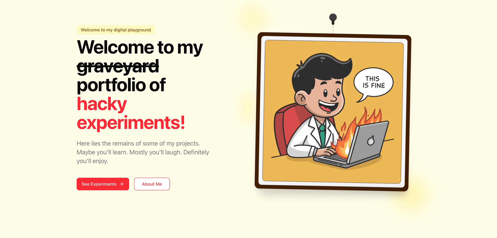

# Hacky Experiments

<div align="center">
  
</div>

**An open source playground for my experiments**

## 👋 Welcome

Welcome to Hacky Experiments! This repository is home to my coding experiments, side projects, and technical explorations. Each project represents a unique journey into technology, problem-solving, and creative coding. I'm passionate about building, iterating quickly, and learning along the way.

## 🔍 What's Inside

Inside this repository you'll find:
- **Experiments**: A collection of coding experiments and side projects. These are external projects.
- **Blog**: Posts and insights on my technical explorations.
- **Micro Experiments**: Small, focused experiments designed for quick demos. They will be part of the codebase here.

Each project comes with its own setup instructions—simply navigate to the project directory and check out its README for installation and usage details.

## 🚀 Getting Started

1. Clone the repository.
2. Choose the project you're interested in.
3. Follow the instructions provided in the project's README file.

## Content and images

Experiments are ordinary Markdown with validated YAML metadata in `content/experiments/`. Blog articles remain MDX in `content/blog/`. Pages, metadata, search and the sitemap read these files; the running website does not use Contentful.

Images live in one Cloudflare R2 bucket. `content/media.json` contains portable object keys, dimensions and checksums. Before each build, missing images are downloaded into `public/media/`, verified and deployed with the website. Next.js Image creates responsive versions on demand and caches them; visitors receive those versions through the website host's image endpoint. Originals remain available at `/media/`. Image delivery uses the website host's bandwidth. No custom media domain is required.

Copy `.env.example` to `.env.local`, set mode `600`, and configure your site URL and R2 account, key and bucket. Keep credentials out of Git. A read-only R2 key is sufficient for builds; the upload tool requires object read/write permission. The keys are never exposed to browsers. For an existing public CDN, `NEXT_PUBLIC_MEDIA_BASE_URL` can optionally replace build-time downloads.

```sh
npm ci --legacy-peer-deps
npm run content -- prepare
npm run dev

# Upload an image and create a draft
npm run content -- add-image ./hero.png --id my-project-hero --description "Describe the image"
npm run content -- new my-project --title "My Project" --description "One sentence." --hero my-project-hero

# Validate, test and build
npm run content -- validate --files
npm run test:content
npm run build
```

Draft posts are excluded from public pages and the sitemap; their source and images may still be public. `npm run content -- publish my-project` verifies the hero and marks the Markdown ready for publication. Review, commit and deploy separately, then verify the live URL. Uploading a replacement image uses a new ID and hashed key, preserving old images for rollback.

The optional `content:import` command reads a Contentful collection into this format. It preserves original dates and content, downloads original images and stops on unsupported formatting or unresolved references. Contentful credentials are needed only for this one-time import. Raw exports and downloaded files are ignored by Git.

Articles also support `.md` URLs and `Accept: text/markdown`. Markdown responses carry a canonical link and are not cached. Next.js may overwrite `Vary` on HTML responses, so outside Vercel the article routes use private, always-revalidated HTTP caching while retaining static generation. Keep that policy when adding a reverse proxy, or explicitly append `Vary: Accept` after Next.js and configure the proxy to cache each representation separately. Leave `VERCEL` unset outside Vercel. On Vercel, [middleware runs before the CDN cache](https://vercel.com/docs/routing-middleware), so the Markdown rewrite preserves cached HTML delivery.

## Analytics

Analytics uses Umami. Set `NEXT_PUBLIC_UMAMI_SCRIPT_URL` and `NEXT_PUBLIC_UMAMI_WEBSITE_ID` for the production build; both are public tracker settings, not credentials. Leaving either unset disables analytics. The tracker runs only on the apex and `www` hostnames of `NEXT_PUBLIC_SITE_URL` (the configured site URL), so localhost and preview domains are excluded. Umami tracks client-side navigation automatically; query strings and fragments are excluded. Google Analytics is no longer loaded.

## 🛠️ Technologies

My experiments make use of various technologies, including but not limited to:

- **Next.js**
- **Tailwind CSS / Shadcn**
- **Bun** (for scripts)
- **Various APIs**
- And more!

## 📝 License

This repository is licensed under the MIT License. See the [LICENSE](LICENSE) file for details.

## 🤝 Contributing

These projects are personal experiments, but I welcome suggestions, bug reports, and pull requests. Feel free to open an issue to discuss any ideas or improvements.

## 📫 Contact

Have questions or want to reach out? You can:
- Open an issue in this repository
- Connect with me on [Twitter](@deepwhitman)

---

> "All life is an experiment. The more experiments you make, the better."  
> — Ralph Waldo Emerson

If you're curious about how I build stuff and continuously improve through rapid iteration, you're in the right place. Let's build, experiment, and embark on this adventure together!

---

Created with ☕ by [Bilal Tahir](https://github.com/btahir)
